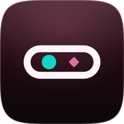

<div align="center">




# LeFleur Atoll

### Минималистичный «островок» в стиле Dynamic Island для Windows (на базе Atoll)

**«Островок» как на iPhone — только на компьютере.**
Музыка со словами песен, погода, таймеры, скриншоты с распознаванием и переводом текста, чат с ИИ, буфер обмена,
заметки, календарь, уведомления и маленький персонаж, который живёт в пилюле, — в одном мягком, пружинистом острове наверху экрана.

[English](README.md) · **Русский**

🎬 **[Видео-обзор за полторы минуты](https://github.com/Fuwni/dynamic-island-windows/releases/download/v1.2.0/dynamic-island-review-ru.mp4)** · 🌍 7 языков интерфейса

[](https://github.com/LaRevole/dynamic-island-windows/releases/latest)


[](LICENSE)

</div>

---

## Содержание

- [Обновление LeFleur Atoll 2.3.0](#обновление-lefleur-atoll-230)
- [Как работают обновления](#обновления)
- [Что нового в 1.8](#что-нового-в-18)
- [Что умеет](#что-умеет)
- [Установка за 2 минуты](#установка-за-2-минуты)
- [Как пользоваться](#как-пользоваться)
- [Горячие клавиши](#горячие-клавиши)
- [Персонажи](#персонажи)
- [Claude Code на острове](#claude-code-на-острове)
- [Приватность и безопасность](#приватность-и-безопасность)
- [Частые вопросы](#частые-вопросы)
- [Сборка из исходников](#сборка-из-исходников)

---

<a id="обновление-lefleur-atoll-230"></a>
## Обновление LeFleur Atoll 2.3.0

Форк [Fuwni/dynamic-island-windows](https://github.com/Fuwni/dynamic-island-windows) (актуализирован до базы `v2.2.0` — границы экрана, боковое размещение и панель задач), развиваемый в [LaRevole/dynamic-island-windows](https://github.com/LaRevole/dynamic-island-windows) с упором на практичность, нативные плееры и низкое потребление памяти:

- 🎧 **Нативная поддержка AIMP Remote API (`AIMP2_RemoteInfo`)**: название, исполнитель, альбом, обложка, прогресс, перемотка, повтор и управление воспроизведением без сторонних плагинов для AIMP.
- 🎵 **Встроенная Яндекс Музыка (`https://music.yandex.ru/`)**: отдельный источник во вкладке «Музыка» с поиском, разделом «Коллекция», окнами входа Яндекс ID и автоматическим восстановлением зависших медиа-сессий.
- 🌸 **Минималистичные пресеты LeFleur**: **LeFleur · Светлая** (нежная цветочная розовая гамма с переливом) и **LeFleur · LaRCorp** (тёмно-красный + бирюзовый) в *Настройки → Внешний вид* и по `Ctrl+Alt+T`.
- 🎙️ **Глобальный mute всех микрофонов (`Ctrl+Alt+M`) и постоянный значок в острове**: выключает сразу все активные устройства записи Windows (включая связку разных `Default Multimedia` и `Default Communications`, например для Discord) и держит кликабельный красный значок внутри пилюли, пока микрофон выключен.
- 🌐 **Перевод выделенного текста (`Ctrl+Shift+T` / `Ctrl+Alt+Y`)**: считывает выделение через UI Automation или `Ctrl+C` со скан-кодами без засорения истории буфера, восстанавливает прежний текст буфера и открывает компактную карточку с кнопками **«В заметку»** и **«Скопировать»**.
- 🗣️ **Вкладка «Диктофон» (`TabVoice`, `Ctrl+Shift+R`)**: запись 48 кГц WAV в `Документы\LeFleur Atoll\Voice` с таймером, живым уровнем громкости, предупреждением о выключенном микрофоне и прослушиванием записей прямо в острове.
- 🎨 **Своя иконка LeFleur Atoll**: векторная иконка и логотип в палитре LaRCorp/LeFleur (`Assets/icon.ico`, `docs/icon.png`).
- 🔄 **Автообновления из этого репозитория**: встроенный механизм обновлений переключён с upstream на `LaRevole/dynamic-island-windows`.
- 🖱️ **Фиксы WebView2 и оптимизация ОЗУ**: плавный скролл колёсиком на сайтах без переключения вкладок, видимый скроллбар, общий профиль WebView2 с лимитом кэша, авто-пауза/выгрузка при простое и сжатие буферов стекла (с ~457 МБ при открытом WebView2 до ~61–68 МБ в покое).

---

## Что нового в 1.8

- ↔️ **Размер острова — потянув за край**, и **своя раскладка**: перетащите вкладки и кнопки Главной в свой порядок, скройте лишнее, выберите, что показывает пилюля.
- 🎚️ **Громкость программ**: ползунок для каждой программы, которая издаёт звук.
- 👋 **Шаги первого запуска** и страница **«Проверка»** в настройках: что работает, что нет и почему — с кнопкой «исправить».
- 🔊 **Громкость и яркость** рядом с островом, пока они меняются.
- 📦 **Долгие задачи** (копирование, распаковка, кодирование) видны в пилюле с кольцом.
- 💬 **Сообщения даже без центра уведомлений Windows** («новое сообщение» по счётчику непрочитанных мессенджера).
- 📅 **Вход в звонок** из уведомления календаря одним кликом.
- 🫧 **Стекло работает**, даже когда остров виден на скриншотах и записи экрана.
- 🎨 **Своя тема**, которой можно поделиться одной строкой текста.
- 🖥️ **Переход на монитор, где курсор** (по желанию).

### Раньше, в 1.7

- 🫧 **1.7.1 — Жидкое стекло**: прозрачное матовое стекло, которое у краёв подворачивает то, что за ним, с тонкой радужной каймой; при открытии острова больше нет серой вспышки.
- 🌸☀️🍂❄️ **Темы-сезоны**: анимированные весна, лето, осень и зима прямо в острове.
- 🧠 **Умный остров**: открывается на важном сейчас или на привычной вкладке, не мешает, пока печатаете, бережёт батарею.
- 🎧 **Звонок Discord** — отдельным островком рядом с основным.
- 🖐️ **Перетаскивание** без отставания от курсора.

### Раньше, в 1.6

- 🛠️ **1.6.1**: FPS в играх без выхода из Windows, погода без VPN, Caps Lock и раскладка не сворачивают остров, запись NVIDIA работает, отчёт о плавности.
- 📏 **Размер острова** от 80 до 130 % и режим **«Закрепить на месте»**, чтобы его нельзя было сдвинуть.
- 🙈 **Скрытие поверх выбранных программ** (игра в окне, созвоны) и переключатель **«видно ли остров на скриншотах»** и демонстрации экрана.
- ⌨️ Уведомления о **Caps Lock и смене раскладки**.
- 📝 **Заметки** принимают длинный текст целиком, Shift+Enter — новая строка.
- 💬 **Большой чат**, чтобы капча при входе помещалась. 🛡️ **Плитка VPN** открывает ваше VPN-приложение (Happ, Hiddify, v2rayN, Amnezia…).

### Раньше, в 1.5

- 🪶 **Плавнее**: анимации ровно в 60 кадров, перетаскивание без рывков, облегчённая графика для слабых ПК.
- 🎵 **Музыка**: волна под треком, повтор в любом плеере, ♥ избранное, Яндекс Музыка.
- 🔀 **Несколько активностей**: колесо мыши над пилюлей переключает звонок, музыку, таймер…
- ⌨️ **Ctrl+Alt+O** открывает остров. 🎨 **Темы**, галерея тем из интернета и своё фото.
- 🤖 **Codex** на острове и **9 нейросетей** в чате.
- 🔒 Пароли из менеджеров паролей не попадают в историю буфера.

### Раньше, в 1.4

- 🚀 **Приложения на главной**: любимые программы одной строкой внизу острова. Кнопка **+**, вводите название — готово (и приложения из Microsoft Store).
- 🎛️ **Пункт управления**: Wi‑Fi, Bluetooth, режим «в самолёте», VPN, батарея, блокировка, сон, перезагрузка, выключение.
- 🧹 **Чистый рабочий стол**: значки прячутся одной кнопкой, панель задач остаётся.
- 🎮 **FPS в играх**: пилюля показывает FPS игры и нагрузку CPU / GPU.
- 👆 Открытый остров **закрывается кликом мимо него**.

### Раньше, в 1.3

- ✨ **Новое имя и логотип — Atoll.** Атолл — это кольцевой остров: знак и есть это кольцо с одной тёплой «живой» точкой в лагуне. Минимализм, который читается даже в 16 px в трее.
- 🔄 **Автообновление**: остров сам сообщит о новой версии, обновление в один клик («Настройки → Поведение → Обновления»).
- 📦 **Установщик и быстрое удаление** (с версии 1.2.1): установка без прав администратора, ярлык в «Пуске», автозапуск и «Настройки → Поведение → Удалить Atoll».

### Раньше, в 1.2

- 🌍 **Интерфейс на 7 языках**: английский, русский, украинский, испанский, немецкий, португальский и китайский. Язык берётся из Windows, сменить можно в «Настройки → Поведение». Даты, единицы и быстрые напоминания («завтра 9:00», «через 20 мин», «tomorrow 9:00», «明天 9:00») понимаются на любом языке.
- 🎨 **Новая иконка**: фиолетовый «сквиркл» с островком, глазками и тёплым свечением.
- 🧰 Инструменты для промо-роликов и скриншотов прямо из приложения (`--snapshot`, `--brand`, `--promo`, `--review`, `--live-demo`).

### Раньше, в 1.1

Полный список — в **[CHANGELOG.md](CHANGELOG.md)**. Главное:

- 🧸 **37 персонажей** живут в пилюле *и* в открытом меню и реагируют на ваши действия. **Нажмите на персонажа** — он покажет одну из **7 эмоций**.
- ✏️ **Рисованный стиль**: персонажи двигаются покадрово (12 кадров в секунду) с «дрожащим» чернильным контуром.
- 🟠 Персонажи **Claude** и **Claude Code**. Claude Code поворачивается боком, открывает ноутбук и печатает, пока вы пишете ИИ.
- 💧 **Остров тянется к курсору** всем телом, открывается с мягким размытием и лёгким цветовым расслоением, приземляется с пружинкой.
- 🧊 **Матовое стекло** с настройкой оттенка, полупрозрачный низ и **переливающаяся подсветка** в покое (5 палитр).
- 📌 **Режим «У края»**: остров вырастает из верхнего края экрана, а не плавает.
- ⌨️ **Командная строка** (`Alt+Space` / `Ctrl+Alt+Space`): запуск программ, сайты, поиск, действия.
- 🗂 **Полка** для файлов и **инструменты текста** (исправить раскладку, регистр, транслит, очистка).
- 🔒 **Защита и исправления**: город и вход в нейросети больше не сбрасываются после перезагрузки, нет ложного «в канале Discord», закрыты уязвимости.

---

## Что умеет

<p align="center">
  
  
</p>
<p align="center">
  
  
</p>

**В свёрнутом виде** остров показывает время и погоду, а когда что-то происходит — «живую активность»:

| | |
|---|---|
| 🎵 **Музыка** | обложка и эквалайзер; по желанию — строка песни прямо в пилюле (караоке) |
| ⏱ **Таймер / помодоро / секундомер** | кольцо прогресса и обратный отсчёт |
| ⬇️ **Загрузки** | имя файла и скорость, уведомление по окончании |
| 📅 **Календарь** | «Созвон · через 12 мин» и напоминание за 10 минут |
| 🎧 **Discord** | «в канале» / «говорят» во время звонка |
| 🌙 **Не беспокоить** | сколько осталось тишины |
| 🎮 **Игровой режим** | CPU / GPU / RAM вместо полного скрытия в игре |
| 🟠🟢 **Микрофон и камера** | точки, как на iPhone, когда их кто-то использует |
| 💬 **Сообщения** | Telegram, Discord, Viber… всплывают на острове, счётчик непрочитанных |
| 🤖 **Claude Code** | запросы разрешений с кнопками «Разрешить / Запретить», «Claude закончил» |

**В развёрнутом виде** — 10 вкладок:

| Вкладка | Что там |
|---|---|
| 🏠 Главная | быстрые действия: скриншот области / экрана, текст с экрана, QR-код, пипетка, чистый текст, запись экрана, своя команда; мини-плеер и погода |
| 🎵 Музыка | любой плеер из системного окна громкости (Spotify, Яндекс Музыка, браузеры, Apple Music, AIMP, Winamp…); перемотка, громкость именно этого плеера, слова песен из [LRCLIB](https://lrclib.net) |
| ☀️ Погода | впишите город и нажмите Enter: компас ветра, влажность, давление, солнце на дуге, УФ, осадки, прогноз по часам ([Open-Meteo](https://open-meteo.com), без ключей) |
| 💬 Чат | Claude, Gemini или DeepSeek прямо в острове; один раз войдите, ключи не нужны |
| ⏱ Таймер | таймер, помодоро (может включать «Не беспокоить»), секундомер |
| 📋 Буфер | последние 30 скопированных текстов, картинок и файлов, полка и инструменты текста; хранится только в памяти |
| 📝 Заметки | Enter — сохранить, Shift+Enter — новая строка |
| 📅 Календарь | напоминания словами (`18:30`, `завтра 9:00`, `через 20 мин`) и ваш Google / Outlook / Яндекс календарь по секретной ICS-ссылке |
| 🖥 Система | нагрузка CPU / GPU / RAM, микрофон и звук Discord, «Не беспокоить» на 30 мин / 1 ч / 2 ч, кто использует микрофон и камеру, заряд устройств |
| ⚙️ Настройки | внешний вид, персонаж, главная, поведение, действия, Claude Code |

**И ещё:** редактор скриншотов (ручка, маркер, ластик, распознать и перевести текст, QR); перетащите файл на остров — поделиться, сжать в ZIP, конвертировать;
остров можно двигать мышью и **смахнуть вверх**, чтобы спрятать; сам прячется в играх и полноэкранном видео; тёмная и светлая тема, 10 цветов или свой.

<p align="center">
  
  
</p>

---

## Установка за 2 минуты

Права администратора не нужны.

**Установщик (рекомендуется)**

1. Откройте **[Releases](https://github.com/LaRevole/dynamic-island-windows/releases/latest)** и скачайте **`Atoll-…-setup.exe`**.
2. Запустите его. Он ставит программу только для вас (без прав администратора), добавляет её в меню «Пуск» и может включить автозапуск.
3. Windows может показать синее окно **«Windows защитила ваш компьютер»**: программа не подписана платным сертификатом.
   Нажмите **«Подробнее» → «Выполнить в любом случае»**. Это нужно один раз.

**Портативная версия (без установки)**: скачайте `DynamicIsland-…-win-x64.zip`, распакуйте куда угодно и запустите `DynamicIsland.exe`.

> .NET ставить не нужно — всё уже внутри.

**Требования**

| Что | Зачем | Где взять |
|---|---|---|
| Windows 10 (2004+) или 11, 64-бит | — | — |
| Microsoft Edge WebView2 Runtime | вкладка «Чат» | в Windows 11 уже есть; иначе — [скачать](https://developer.microsoft.com/microsoft-edge/webview2/) |
| Visual C++ Redistributable 2015–2022 (x64) | запись экрана | обычно уже стоит; иначе — [скачать](https://aka.ms/vs/17/release/vc_redist.x64.exe) |

<a id="обновления"></a>
**Обновление (автоматически и вручную):**
- **Автопроверка:** LeFleur Atoll проверяет свежие релизы в **[LaRevole/dynamic-island-windows](https://github.com/LaRevole/dynamic-island-windows/releases)** при старте и каждые 6 часов (включается/выключается в **Настройки → Поведение → Обновления**).
- **Версия с установщиком:** при нажатии на уведомление или кнопку **«Обновить»** скачивается `Atoll-…-setup.exe` по HTTPS, проверяется контрольная сумма SHA-256 с GitHub, и установка проходит поверх текущей версии с сохранением всех настроек и заметок.
- **Портативная версия (`DynamicIsland-win-x64.zip`):** открывается страница релиза на GitHub для скачивания нового архива (распакуйте с заменой файлов).
- **Вручную:** просто запустите новый установщик поверх старого — настройки и заметки сохранятся.

**Удалить (10 секунд):** **Настройки → Поведение → «Удалить Atoll»** или **Параметры Windows → Приложения → Установленные приложения → Atoll → Удалить**.
Удаляются программа, ярлык в «Пуске», автозапуск и хуки Claude Code; настройки, заметки и вход в чаты — по вашему выбору.
Та же кнопка работает и в портативной версии: она всё почистит и удалит свою папку.

---

## Как пользоваться

| Действие | Что произойдёт |
|---|---|
| Навести мышь | раскроется (или по клику — см. настройки) |
| Увести мышь | свернётся |
| **Перетащить** | переедет куда угодно и запомнит место |
| **Смахнуть вверх** | спрячется; наверху останется тонкая полоска |
| Клик / потянуть полоску | вернётся |
| **Клик по персонажу** | случайная эмоция 🙂 |
| Правый клик | меню: спрятать, тема, настройки, выход |
| Перетащить файл на остров | действия с файлом |

## Горячие клавиши

| Клавиши | Действие |
|---|---|
| `Ctrl` + `Alt` + `I` | показать / спрятать остров |
| `Ctrl` + `Alt` + `S` | скриншот области |
| `Ctrl` + `Alt` + `R` | начать / остановить запись экрана |
| `Ctrl` + `Alt` + `T` | тёмная ↔ светлая / тема LeFleur |
| `Ctrl` + `Alt` + `M` | включить / выключить микрофон во всей системе |
| `Ctrl` + `Shift` + `T` / `Ctrl` + `Alt` + `Y` | перевести выделенный текст |
| `Ctrl` + `Shift` + `R` | начать / остановить диктофон |
| `Alt` + `Space` или `Ctrl` + `Alt` + `Space` | командная строка (другое сочетание или выкл.: Настройки → Поведение) |

В редакторе скриншота: `Ctrl+Z` — отменить, `Ctrl+C` — копировать, `Ctrl+S` — сохранить, `Esc` — закрыть.

---

## Персонажи

<p align="center"></p>

Выбираются в **Настройки → Персонаж**. Персонаж живёт в свёрнутой пилюле и в шапке открытого меню:

- следит глазами за курсором и моргает;
- танцует под музыку, думает, пока работает Claude Code, засыпает, когда вас нет;
- подпрыгивает от нажатий и смены страниц, радуется, когда вы что-то включаете, печатает вместе с вами;
- здоровается, когда открывается меню.

**Нажмите на него** — покажет одну из семи эмоций: влюблённость, злость, удивление, грусть, головокружение, смех или крутые очки.

<p align="center"></p>

**Claude** — оранжевая «искра»: лучи волной вытягиваются и втягиваются, сама не крутится.
**Claude Code** — пиксельный маскот: когда пишете во вкладке «Чат», он запрыгивает на окно чата, поворачивается боком, открывает ноутбук и печатает; перестали — закрывает крышку и поворачивается обратно.
Их оранжевую подсветку можно выключить там же.

**Нарисовано от руки (покадрово)**: все персонажи двигаются «через кадр», с чернильным контуром, который чуть дрожит от кадра к кадру.

<p align="center"></p>

---

## Claude Code на острове

Если вы пользуетесь [Claude Code](https://claude.com/claude-code), остров покажет его запросы разрешений
(«хочет выполнить `dotnet build`») с кнопками **Разрешить / Запретить / В терминале** и сообщит, когда Claude закончил.

Включение: **Настройки → Claude Code → «Подключить»**. Остров добавит свои хуки в `~/.claude/settings.json`
(рядом сохранится резервная копия), «Отключить» уберёт только их. Если остров закрыт, Claude Code спросит в терминале, как обычно.

---

## Приватность и безопасность

Остров ничего не собирает, телеметрии нет. Внешние запросы — только для функций, которые вы видите:

| Функция | Куда | Что уходит |
|---|---|---|
| Погода | open-meteo.com | город / координаты |
| Слова песен | lrclib.net | название трека и исполнитель |
| «Перевести» в редакторе скриншота | translate.googleapis.com | распознанный текст — **только по нажатию** |
| Чат | сайт выбранного чата | то, что вы сами пишете |
| Календарь | ваша ICS-ссылка | — |

Распознавание текста, QR, запись экрана и буфер работают **локально**. Настройки и заметки — в `%APPDATA%\DynamicIsland`,
вход в чаты — в `%LOCALAPPDATA%\DynamicIsland\WebView2`, журнал ошибок — `%LOCALAPPDATA%\DynamicIsland\log.txt`.
В релиз не попадает ничего личного: новая установка начинается без города, без аккаунтов и с настройками по умолчанию.

Меры защиты описаны в **[SECURITY.md](SECURITY.md)**: локальный мост Claude Code с секретным ключом, ссылки открываются только http/https,
чат не может запускать программы. Нашли проблему — сообщите, как там написано.

---

## Частые вопросы

**Это бесплатно?** Да, полностью: без подписок и рекламы, лицензия MIT.

**Там нет вирусов?** Нет. Весь код открыт в этом репозитории — его можно прочитать или собрать самому. Atoll ставится без прав администратора.

**Есть версия для Linux или macOS?** Нет, только Windows 10 и 11: приложение написано на WPF — это технология Windows.

**Сколько памяти занимает?** Обычно 250–400 МБ — примерно как пара вкладок браузера. На слабом ПК включите «Настройки → Поведение → Облегчённая графика»: без стекла и свечения (на слабых ПК она включается сама).

**Нужен ли интернет?** Только для погоды, текстов песен и их перевода, чатов с нейросетями, обновлений и галереи тем. Остальное работает без сети.

**Как удалить?** «Настройки → Поведение → Удалить Atoll» или «Параметры Windows → Приложения».

**Синее окно «Windows защитила ваш компьютер».** Программа не подписана платным сертификатом: «Подробнее» → «Выполнить в любом случае».

**Остров не виден в игре.** Так задумано («Прятать в играх и полноэкранном режиме»). Вместо этого можно включить «В играх показывать FPS и нагрузку». Для игр в окне есть «Прятать остров поверх программ».
Поверх игр в «эксклюзивном полноэкранном» режиме ничего показать нельзя — переключите игру в «оконный без рамки».

**Острова нет на моих скриншотах.** По умолчанию он прячется от скриншотов, записи и демонстрации экрана. Выключите «Настройки → Поведение → Скрывать остров на скриншотах и демонстрации экрана» — стекло тогда станет сплошным, иначе остров фотографировал бы сам себя.

**Не показывается заряд наушников.** Некоторые гарнитуры (например, Logitech G435) вообще не передают заряд компьютеру — его не видит даже фирменная программа.

**Не входит в Gemini / Claude через Google.** Google иногда запрещает вход во встроенных окнах. Войдите по почте или нажмите ↗, чтобы открыть чат в браузере.

**Сообщения мессенджеров не появляются.** Мессенджер должен показывать уведомления Windows, а Windows — разрешать доступ к уведомлениям.

**Сочетание клавиш не работает.** Его заняла другая программа; причина записана в `%LOCALAPPDATA%\DynamicIsland\log.txt`.

---

## Сборка из исходников

Нужен [.NET 10 SDK](https://dotnet.microsoft.com/download).

```bash
git clone https://github.com/LaRevole/dynamic-island-windows.git
cd dynamic-island-windows
dotnet run -c Release
```

Версия для раздачи (всё включено, .NET у пользователя не нужен):

```bash
dotnet publish -c Release -r win-x64 --self-contained true -o publish/DynamicIsland
```

Скриншоты для README делает сама программа на демо-данных (без настоящих аккаунтов и мест):

```bash
DynamicIsland.exe --snapshot docs/screenshots
```

Подпись кода: сборка в GitHub Actions подписывает exe, dll и установщик (Authenticode), если в секретах репозитория есть сертификат — `SIGN_CERT_PFX` (файл .pfx в base64), `SIGN_CERT_PASSWORD` и по желанию `SIGN_TIMESTAMP_URL`; без них собирается без подписи, как раньше. Подробно — в [английском README](README.md#code-signing).

Устройство проекта и остальное — в [английском README](README.md#project-layout). Каждый push собирается в GitHub Actions — готовый архив во вкладке **Actions → артефакты**.

---

<div align="center">

Сделано с любовью к мелочам · [MIT License](LICENSE)

</div>
